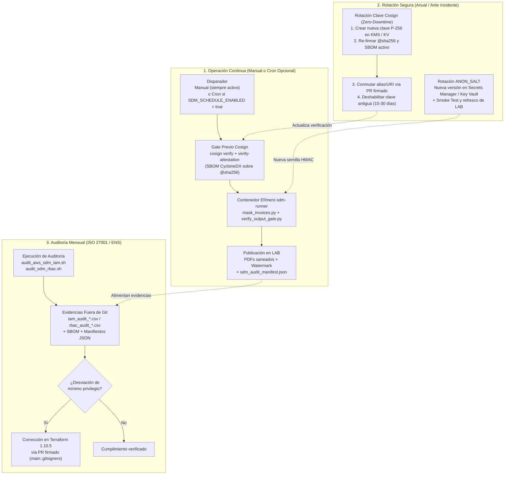

# Arquitectura y Modelo de Seguridad (Zero-PII SDM)

## 1. Principios de diseño
* **Zero-PII en tránsito y reposo en LAB:** Toda PII detectada fuera de `ISSUER_WHITELIST` se sustituye mediante HMAC-SHA256 (`ANON_SALT`) y se valida en `verify_output_gate.py`.
* **Mínimo privilegio (OIDC):** Cero credenciales estáticas; roles segregados por función (`prod-ro`, `lab-rw`, `ecr-sign`, `iam-audit`, `release-ro`).
* **Cadena de suministro inmutable:** Verificación obligatoria de firma Cosign y *attestation* SBOM CycloneDX sobre `@sha256:...` antes de ejecutar `sdm-runner`.

## 2. Ciclo de vida de operación, rotación y auditoría

